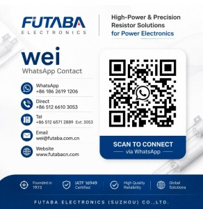

### FUTABA | High-Power & Precision Resistor Solutions for Power Electronics

### FUTABA Electronics (Suzhou) Co., Ltd.

Founded in 1973 in Taiwan, FUTABA has dedicated over 50 years to the research, development, and manufacturing of high-performance resistors. Through the coordinated operations of our Taiwan headquarters, Suzhou factory, Hunan factory, and Shenzhen office, FUTABA provides reliable, high-quality resistor solutions for industrial and technological applications worldwide.

### Product Range

- Wirewound Resistors

- Metal Oxide Film Resistors

- Metal Glaze Resistors

- Fuse Resistors

- High-Power Resistors

- Explosion-Proof & High Pulse Resistors

- Cement & Aluminum Enclosed Resistors

### Manufacturing & Management Structure

- **Taiwan Headquarters:** Research & development, high-end product development

- **Suzhou Factory:** Finished product manufacturing, certified with IATF 16949 quality management system

- **Hunan Factory:** Semi-finished and finished product production, offering flexible support for industrial partnerships

### Quality & Reliability

Quality and reliability are at the core of FUTABA’s principles.  
Our group maintains ISO9001, ISO14001 certifications and holds UL, Sony Green Partner, CQC, TUV, and other regulatory compliance certifications. Our standard quality control laboratories follow JISC5201 testing procedures to ensure products meet high industrial standards.

FUTABA has a strong R&D team committed to new product development, offering tailored solutions to meet customer requirements, consistently receiving high praise.

### Our Philosophy

FUTABA is not just a manufacturer; we are a systematic provider of stable, high-performance resistor solutions, delivering consistent quality, mature systems, and reliable supply to customers worldwide.

### Contact Us

**FUTABA Electronics (Suzhou) Co., Ltd.**

- **WeChat:** +86 186 2619 1206

- **Direct:** +86 512 6610 3053

- **Tel:** +86 512 6571 2889 Ext: 3053

- **Email:** wei@futaba.com.cn

- **Web:** [www.futabacn.com](http://www.futabacn.com)

- **WhatsApp:** Scan the QR code below to contact Wei  
    
