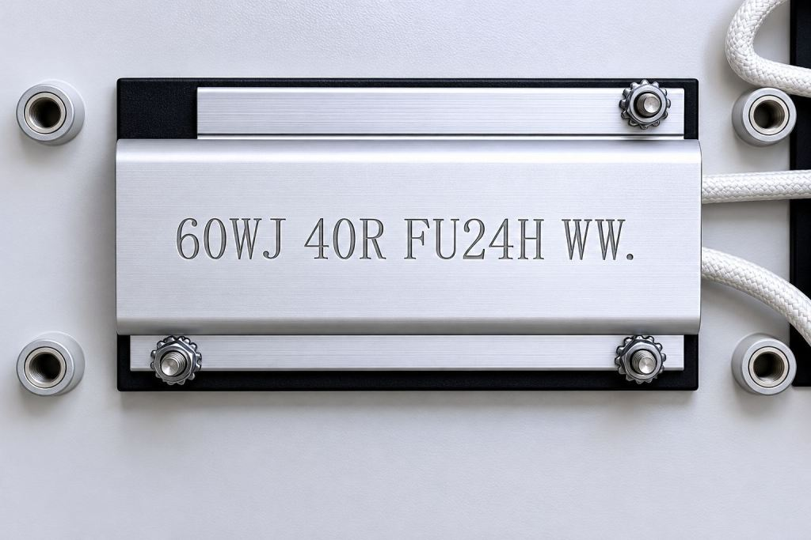

In modern power electronics design, especially in energy storage systems (ESS) and high-power inverter development, power resistor selection is often simplified to matching rated power and resistance value. In actual operation, however, the challenges faced by a resistor go far beyond this. The core risk lies in thermal stress and material fatigue caused by instantaneous pulse surges.

### Engineering Challenges of Pulse Loading

At the moment of switching in a servo drive or inverter, the circuit can generate peak currents several times or even dozens of times higher than the rated value. These short-duration but high-intensity pulses can cause the internal temperature of the resistor to rise rapidly in an extremely short time.

From an engineering perspective, the key factor determining resistor reliability is not average power, but single-pulse energy:

**E = I² × R × t**

When the pulse energy (I²t) exceeds the resistor’s withstand capability, the resistor may fail even if the rated power appears sufficient. Localized overheating can lead to resistance drift and even structural damage, eventually causing system failure.

### The Underlying Failure Mechanism of Pulse Stress

Pulse loading is essentially a form of “thermal shock cycling.” Its main failure paths include:

- **Thermal expansion fatigue:** repeated thermal shock causes failure in the resistance wire or film layer.

This is the fundamental reason behind a common engineering phenomenon:

**“Rated power is sufficient, yet the resistor still fails.”**

### Balancing Performance, Cost, and Lead Time

For a long time, the industry has tended to choose internationally recognized brands under high-reliability requirements. However, this strategy is now facing practical challenges:

- **Cost pressure:** imported resistors are significantly more expensive than comparable alternatives

- **Lead-time risk:** delivery times for some models have been extended

For energy storage or industrial automation projects, which usually have project cycles of only a few weeks to several months, this uncertainty has become a critical risk.

### Engineering Feasibility of Domestic Alternatives

From the perspective of material systems and structural design, high-performance domestic power resistors have become increasingly competitive in recent years:

- Optimized wire-wound structures to reduce localized hot spots

- Enhanced pulse withstand capability

Taking **FUTABA** as an example, its pulse-resistant series products have already been validated in ESS PCS and industrial drive applications. Under typical millisecond-level pulse conditions, the products demonstrate stable electrical performance, while lead time is generally controllable within **3–6 weeks**, offering strong engineering adaptability.

### Selection Recommendations for Different Applications

In practical applications, selection should follow the principle of **“pulse first, power second, cost last.”**

#### 1\. Signal Sensing Circuits

It is recommended to use **metal oxide resistors** or **wire-wound resistors**, with emphasis on temperature coefficient performance and long-term stability.

#### 2\. High-Power Braking and Discharge Circuits

Prefer **aluminum-housed resistors** or **high-pulse wire-wound resistors** to withstand high-frequency surges and thermal loads.

#### 3\. General Power Supply and Basic Circuits

Where pulse requirements are low and cost sensitivity is high, **cement resistors** still offer good cost-performance value.

### The Importance of Supply Chain Certainty

For large-scale equipment manufacturers, product reliability depends not only on component performance, but also on supply chain responsiveness.

A supply system with localized manufacturing capability, such as a multi-factory layout, has clear advantages in the following areas:

- Rapid response to design changes

- Support for mass production scaling

- Lead time reduced from “months” to “weeks”

In the highly competitive ESS and industrial automation markets, this kind of supply chain certainty is often more valuable in practice than parameter advantages alone.

