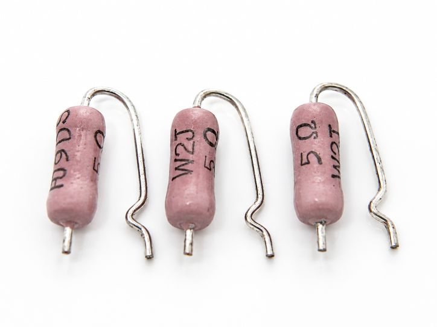

## Application Background

As one of the most established resistor technologies, wirewound resistors play an **indispensable role** in industrial automation, power systems, rail transit, and other critical sectors. Compared to standard resistors, wirewound resistors are the preferred solution for high-power scenarios due to their exceptional power-handling capacity and long-term stability.

In applications requiring high-power dissipation—such as **frequency converter braking, motor starting, and power supply filtering**—Futaba wirewound resistors utilize their unique structural design to effectively absorb and dissipate excess energy, protecting equipment from voltage surges and overload damage.

## Technical Principles

The core principle of a wirewound resistor is based on the winding structure of resistance wire. High-resistivity alloy wires (such as **Constantan or Manganin**) are wound onto an insulating mandrel. The specific resistance value is achieved by precisely controlling the material, diameter, and winding length of the wire.

### Structural Characteristics:

- **Resistive Material:** Selected alloys with a low Temperature Coefficient of Resistance (TCR) and high oxidation resistance.

- **Insulating Core:** Typically made of ceramic or mica, offering excellent heat resistance and dielectric strength.

- **Encapsulation:** Various forms including aluminum housing, epoxy resin coating, or specialized non-inductive windings.

- **Thermal Design:** Enhanced power density achieved through increased surface area and integrated heat sink designs.

### Performance Advantages:

- **Wide Power Range:** From a few watts to several kilowatts.

- **Low Temperature Coefficient:** High stability with minimal resistance drift across temperature fluctuations.

- **Superior Overload Capacity:** Capable of withstanding short-term high-current impulses.

- **Extended Service Life:** Can reach tens of thousands of hours under rated conditions.

* * *

## Common Challenges & Solutions

### 1\. Inductive Effects

Traditional wirewound resistors generate significant parasitic inductance due to their helical structure, which may impact circuit performance in high-frequency applications.

- **Solutions:** \* Adopt **non-inductive winding techniques** (e.g., Ayrton-Perry winding).
    - Select surface-mount (chip) wirewound resistors.
    
    - Switch to metal film resistors for strictly high-frequency requirements.

### 2\. Heat Dissipation Challenges

High-power resistors generate intense heat. Improper thermal management can lead to:

- Resistance value drift.

- Aging of insulation materials.

- Risk of burnout.

- **Mitigation:** \* Ensure adequate installation space and ventilation.
    - Use **thermal grease** to improve heat conduction to chassis.
    
    - Choose specialized models with integrated heat sinks.

* * *

## Selection Recommendations by Scenario

### Industrial Braking:

- **Recommended:** **Futaba Aluminum-housed resistors** (high power density, superior cooling).

- **Tolerance:** $\\pm 5\\%$ is usually sufficient; prioritize **power margin**.

- **Feature:** Choose models with high pulse-load capability.

### Power Filtering:

- **Priority:** **Non-inductive** wirewound resistors.

- **Focus:** Temperature coefficient and long-term stability.

- **Tolerance:** Suggested $\\pm 1\\%$.

### Testing & Measurement:

- **Selection:** High-precision wirewound resistors ($\\pm 0.1\\%$).

- **Focus:** TCR and aging characteristics.

- **Consideration:** **Shielded encapsulation** to minimize electromagnetic interference.

* * *

## The Futaba Advantage

As a professional resistor manufacturer, **Futaba (双羽电子)** offers distinct advantages in the wirewound field:

### Technical Excellence:

- **Proprietary Alloy Formulas:** TCR controlled within **$\\pm 50\\text{ ppm}/^\\circ\\text{C}$**.

- **Precision Winding Process:** Ensures excellent resistance consistency and stability.

- **Versatile Packaging:** Multiple encapsulation forms to meet diverse application needs.

### Quality Assurance:

- Full-process quality control with **100% burn-in (aging) testing** before delivery.

- Fully compliant with **RoHS** environmental standards.

- Comprehensive technical support and engineering services.

### Cost-Effectiveness:

- Significant price advantage over international Tier-1 brands with equivalent performance.

- **Localized production** ensuring short lead times and agile supply chain management.

- Flexible customization services for specialized requirements.

## Conclusion

While wirewound resistors are a mature technology, scientific selection based on specific application scenarios remains vital in power electronics. As industrial automation evolves, the performance requirements for these "power guardians" continue to rise.

Choosing a reliable supplier is essential. With years of technical expertise and rigorous quality control, **Futaba** provides stable, high-performance, and cost-effective solutions. Whether you require standard aluminum-housed resistors or specialized non-inductive components, we have the right solution for you.

* * *

_Technical support provided by the Futaba Technical Team. For further selection advice, please consult our professional engineers._

