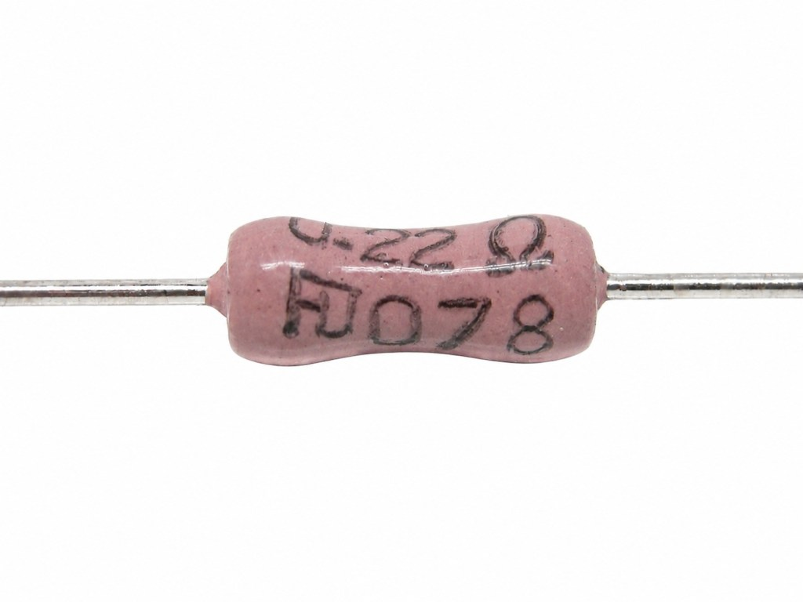

In electronic component selection, many engineers come across **Metal Oxide Film Resistors**. They are widely used in power supplies, industrial control systems, home appliance control boards, and charging equipment. Their main features include:

- Good high-temperature resistance

- Good long-term stability

- Better overload capability

- Cost-effective performance

Therefore, metal oxide film resistors are widely used in the fixed power resistor market.

* * *

### 1\. What Is a Metal Oxide Film Resistor?

A metal oxide film resistor is a fixed resistor made by forming a layer of metal oxide conductive film on a ceramic substrate, then adjusting the resistance value through trimming or cutting processes.

Its common structure includes:

- Ceramic rod substrate

- Metal oxide conductive film layer

- Insulating protective coating

- Lead wire and end cap structure

This structure provides a balance of mechanical strength, insulation, and heat dissipation, making it suitable for long-term powered applications.

* * *

### 2\. Main Advantages of Metal Oxide Film Resistors

### 1\. Good High-Temperature Performance

Metal oxide film materials offer good thermal stability and are suitable for:

- Switching power supplies

- LED drivers

- Industrial control boards

- High-temperature areas in appliances

### 2\. Good Long-Term Stability

Under continuous load conditions, resistance drift is usually low, making them suitable for products requiring long service life.

### 3\. Better Overload Capability

Under voltage fluctuation conditions, they generally perform better than standard carbon film resistors.

### 4\. Balanced Cost and Performance

When customers need both stability and cost control, metal oxide film resistors are often a practical choice.

* * *

### 3\. What Is the Difference Between Metal Oxide Film and Metal Film Resistors?

Many buyers confuse these two types, but their application focus is different.

| Item | Metal Oxide Film Resistor | Metal Film Resistor |
| --- | --- | --- |
| Accuracy | Medium | Higher |
| Temperature Coefficient | Medium | Better |
| High-Temperature Resistance | Better | Medium |
| Moisture Resistance | Better | Lower |
| Typical Applications | Power Supply, Industrial Control | Precision Circuits, Signal Circuits |

### Simple Understanding:

- If high precision and low temperature drift are required → **Metal Film Resistor**

- If durability, stability, and power handling are required → **Metal Oxide Film Resistor**

* * *

### 4\. Common Application Fields of Metal Oxide Film Resistors

### Power Products

- Switching power supplies

- Chargers

- UPS systems

- Inverter auxiliary circuits

### Industrial Equipment

- PLC control boards

- Automation equipment

- Inverter support circuits

### New Energy Equipment

- Energy storage auxiliary circuits

- EV charger control circuits

* * *

### 5\. What Should Be Considered During Selection?

When selecting components, the following parameters should be confirmed:

### Power Rating

Common ratings include 1W, 2W, 3W, and 5W. They must meet temperature rise requirements.

### Resistance Value

Confirm the target resistance and tolerance.

### Working Voltage

For high-voltage applications, rated working voltage must be verified.

### Size

Check dimensions when PCB space is limited.

### Batch Consistency

For mass production projects, stable quality and long-term supply capability are important.

* * *

### 6\. Why Is Supplier Manufacturing Capability Important?

Metal oxide film resistors are mature products, but actual quality differences often come from manufacturing processes, such as:

- Film coating process stability

- Resistance trimming precision

- Coating insulation consistency

- Aging screening process

- Batch consistency control

Therefore, many industrial customers prefer suppliers with long-term manufacturing experience.

For example, **FUTABA Electronics** has long specialized in power resistor manufacturing. In the metal oxide film resistor field, it has in-house film coating capability, stable conductive layer performance, and experience supporting Japanese resistor manufacturers. Its product range includes metal oxide film resistors, wirewound resistors, cement resistors, and aluminum housed resistors, providing stable supply support for industrial control and power equipment customers.

* * *

### 7\. Summary

If your product requires:

- Long-term stable operation

- High-temperature environment use

- Medium or low power load

- Balanced cost and performance

Then metal oxide film resistors are often worth prioritizing.

They are not the most expensive option, nor the highest precision option, but they are often one of the most practical choices in engineering applications.

