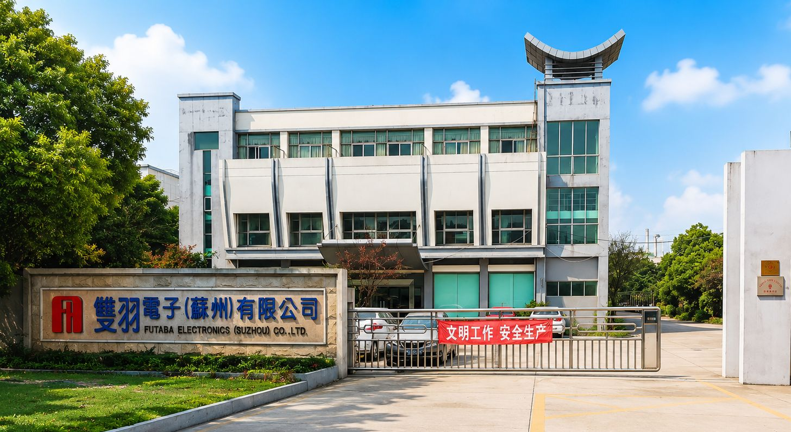

Founded in 1973 in Hsinchu, Taiwan, FUTABA Group has remained dedicated to power resistor manufacturing for more than five decades. Over the years, the company has established a coordinated operational structure consisting of its Taiwan headquarters, Shenzhen office, Suzhou plant, and Hunan plant. For a manufacturing enterprise, true strength is not measured by how many products it has made, but by its ability to connect R&D, production, and quality management into one stable long-term system. FUTABA reflects this kind of disciplined and solid industrial foundation.

In terms of product range, FUTABA is far more than a single-category resistor supplier. Its portfolio includes metal oxide film resistors, metal glaze resistors, wirewound resistors, fuse resistors, metal plate resistors, cement resistors, high power resistors, flameproof resistors, high pulse wirewound resistors, and slim aluminum housed resistors. Resistance values range from 1mΩ up to 60GΩ, while power ratings extend from 1/4W to 2000W. This broad range demonstrates a product structure developed not around isolated items, but around diverse application needs.

FUTABA’s manufacturing division is also clearly organized. Taiwan serves as the headquarters and R&D center, Suzhou focuses on finished product manufacturing, Hunan supports both finished goods and semi-finished production, while the Shenzhen office handles market development and customer service. This structure allows the company to respond efficiently to different product stages and varying customer requirements. Notably, the Suzhou plant has established the **IATF 16949 quality management system**, providing a solid foundation for applications requiring higher quality standards.

The Hunan plant represents another important capability within the group. According to company information, the site undertakes film-coated rods and component sub-assembly production, while also supporting both finished and semi-finished manufacturing. For supply chain cooperation, this capability offers more than production volume—it enables flexible support models and stable semi-finished product supply for business partners.

FUTABA’s real strength is further reflected in its commitment to quality assurance and validation. The group has implemented ISO9001 and ISO14001 systems, while the Suzhou facility maintains IATF 16949. In addition, the company holds certifications or compliance capabilities such as UL / ETL, SONY Green Partner, CQC GB4943-2022, and UL1412. FUTABA also operates a complete in-house quality laboratory and continuously performs reliability testing based on **JIS C 5201**, covering key items such as endurance, heat resistance, humidity resistance, overload, and related performance verification.

For resistor components, stability is never just a slogan. It comes from repeatable process control, traceable quality systems, and verifiable reliability standards.

If one were to summarize FUTABA in a single sentence: **FUTABA is not only a resistor manufacturer, but a company that continuously delivers stable products, mature systems, and dependable supply capability.**

