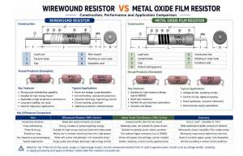

In power resistor selection, wirewound resistors and metal oxide film resistors are two types that are often compared. Both belong to common resistor families, but due to differences in material structure, conduction method, and manufacturing process, they differ significantly in pulse handling capability, power handling, resistance range, and application scenarios.

From an engineering selection perspective, the most important point is this: **wirewound resistors have stronger pulse handling capability and are better suited for high-energy surge applications; metal oxide film resistors are better suited for compact size, higher resistance values, and general stable applications.**

### 1\. What Is a Wirewound Resistor?

A wirewound resistor is made by winding a metal resistance wire around a ceramic core. Its resistance is controlled through a **metal conductor** structure.

Typical construction includes:

- Ceramic core

- Metal resistance wire

- Lead wires and end caps

- Insulation coating

- Marking

This structure allows the resistor not only to handle power stably in a circuit, but also to withstand relatively high energy surges in a short time.

Key characteristics of wirewound resistors:

- Can withstand pulse surges

- Suitable for high-temperature environments

- Good long-term stability

- Low noise

- Suitable for high-power applications

### 2\. What Is a Metal Oxide Film Resistor?

A metal oxide film resistor is a type of film resistor. It is formed by depositing a conductive oxide film layer, such as tin oxide, onto the surface of a ceramic substrate, and then using a cutting process to achieve the target resistance value.

Typical construction includes:

- Ceramic core

- Conductive film layer

- Cutting groove

- Insulation coating

- Marking layer

Its resistance is controlled through a **film-based conductive structure**.

Key characteristics of metal oxide film resistors:

- Suitable for higher resistance values

- Good heat resistance

- Suitable for general power applications

- Relatively moderate cost

- Convenient for compact designs

### 3\. Core Differences Between Wirewound Resistors and Metal Oxide Film Resistors

### 1) Different Conductive Structures

- Wirewound resistor: current flows through a metal wire, which is a solid conductor structure

- Metal oxide film resistor: current flows through a conductive film layer, which is a thin-film structure

Simply put: one is a “wire,” the other is a “film.”

### 2) Significant Difference in Pulse Handling Capability

This is the most important difference between the two.

In practical engineering, resistors often need to withstand instant high-energy surges, such as:

- Capacitor charge and discharge

- Power-on surge

- Lightning surge

- Switching transients

These conditions are generally called **pulse loads**.

The conclusion is very clear:

- Wirewound resistors: strong pulse handling capability

- Metal oxide film resistors: relatively weaker pulse handling capability

The reason is:

- Wirewound resistors use a metal-wire structure with higher thermal capacity and stronger ability to absorb transient energy

- Film resistors are better suited to continuous stable operation, but not to frequent or high-intensity pulse surges

In engineering practice, if a circuit has obvious pulses or surges, wirewound resistors should be selected first.

### 3) Different Focus in Power and Energy Handling

- Wirewound resistors: more suitable for high-energy surges, overloads, and short-duration high-power conditions

- Metal oxide film resistors: more oriented toward general power applications and stable output

Typical wirewound resistor applications include:

- Overcurrent protection

- Current limiting

- Load resistors

- Pulse load applications

- High-energy circuits

- Capacitor charge/discharge circuits

- Current sensing

- Surge absorption

- Lightning protection

- Rectifier circuits

These applications themselves show that wirewound resistors are designed for impact and energy handling.

### 4) Different Resistance Range

Wirewound resistors are more commonly used for low-to-medium resistance and high-power applications, while metal oxide film resistors are more easily made into higher resistance values.

In simple terms:

- Wirewound resistors: better for low resistance, high current, and strong surge conditions

- Metal oxide film resistors: better for higher resistance and general power conditions

### 5) Size Cannot Be Judged Too Simply

Size cannot be directly equated with resistor type. It is more directly affected by power rating, resistance value, package style, and thermal design.

Therefore, it is not accurate to say “wirewound is always larger” or “metal oxide film is always smaller.” A more precise statement is:

- Size is strongly related to power target

- Different package styles can significantly affect final dimensions

- Selection must consider space, power, and heat dissipation together

This is the more rigorous engineering view.

### 4\. Why Do Wirewound Resistors Have Stronger Pulse Handling Capability?

From an engineering perspective, pulse load essentially means a short-term high-power or high-energy surge.

Wirewound resistors are more suitable mainly for three reasons:

### 1) The Metal Wire Structure Better Withstands Instant Energy

The metal resistance wire itself has strong thermal capacity, making it less likely to fail locally under short-term surges.

### 2) The Wirewound Structure Is Better for High-Energy Design

Wirewound resistors can be engineered through resistance value, size, material, and structure to meet different pulse conditions.

### 3) Wirewound Resistors Can Be Selected Using Pulse Curves

In real applications, pulse and temperature derating curves, ambient temperature, and load cycle counts must be considered together. This means wirewound resistors are not only capable of handling the surge, but can also be systematically used in high-impact scenarios.

### 5\. What Are the Advantages of Metal Oxide Film Resistors?

Although metal oxide film resistors are not as strong as wirewound resistors in pulse handling, they still have very clear advantages.

### 1) Suitable for Higher Resistance Designs

For voltage division, sampling, and control circuits, higher resistance values are often important. Metal oxide film resistors are better suited to these applications.

### 2) Good Heat Resistance

Metal oxide film resistors use a tin-oxide film process and are suitable for higher-temperature environments.

### 3) Suitable for General Power Circuits

For applications without obvious pulse surges but with a need for stability, metal oxide film resistors are a good choice.

So, metal oxide film resistors are not “weaker”; they are simply better suited to different applications. They are strong in general power, stability, and higher resistance applications, while wirewound resistors are strong in pulse, high-energy, and impact-load applications.

### 6\. Selection Guidance: Wirewound Resistor or Metal Oxide Film Resistor?

### Choose Wirewound Resistors First When:

If your circuit has the following characteristics, wirewound resistors should be preferred:

- Obvious pulse surges

- Need to withstand surge current

- Capacitor charge/discharge processes

- High load energy

- Need for long-term stable operation

- High-temperature or high-power requirements

### Choose Metal Oxide Film Resistors First When:

If your circuit places more emphasis on the following, metal oxide film resistors may be preferred:

- Higher resistance value required

- General power applications

- No obvious surge load

- Certain space or layout constraints

- Cost-sensitive projects

### 7\. FUTABA’s Strengths in These Two Product Families

In practical selection, it is not enough to look only at the resistor type; manufacturer process capability also matters.

FUTABA has a relatively complete power resistor product portfolio, including:

- Wirewound resistors

- Non-inductive wirewound resistors

- Wirewound fusible resistors

- Flameproof fusible resistors

- Cement resistors

- Aluminum housed resistors

- Metal oxide film resistors

Among them, wirewound resistors feature:

- High pulse withstand capability

- High overload capability

- High lightning surge capability

- Customizable low temperature coefficient

- High-energy design capability

Metal oxide film resistors feature:

- Stable tin-oxide film process

- Good heat resistance

- High-resistance design capability

- Suitable for general power applications

For engineers, the key is not which resistor is “best,” but which resistor is **most suitable for the current application**.

### 8\. Conclusion: Neither Replaces the Other; Application Determines Selection

The difference between wirewound resistors and metal oxide film resistors is fundamentally the performance difference caused by material and structural differences.

Core conclusion:

- Wirewound resistors: strong pulse handling capability, suitable for high-energy, high-impact applications

- Metal oxide film resistors: suitable for high-resistance, general stable circuits

In actual selection, whether pulse loading exists is one of the most important decision criteria.

If the circuit involves surges, capacitor charge/discharge, or transient impact, wirewound resistors should be selected first. If it is a general control circuit that requires a higher resistance value or a more compact design, metal oxide film resistors may offer an advantage.

