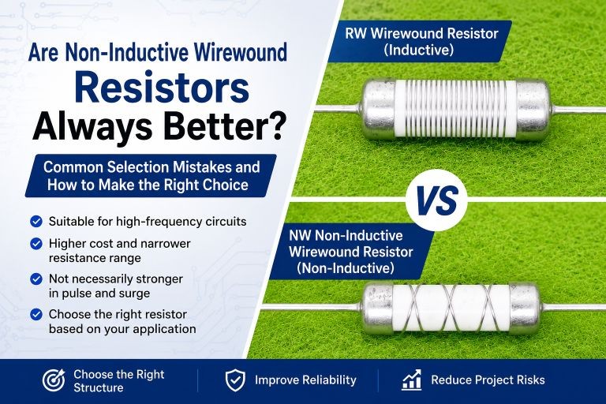

When selecting wirewound resistors, many engineers instinctively assume:

> “Non-inductive wirewound resistors must be better than standard wirewound resistors.”

However, this assumption is not entirely accurate.

A more practical way to understand it is:

> Non-inductive wirewound resistors are better suited for high-frequency circuits because their inductance is more controlled. However, they usually come with higher cost, a narrower resistance range, and their surge or pulse withstand capability is not necessarily better than conventional wirewound resistors.

In other words, resistor selection should not be based solely on whether a resistor is “non-inductive.”  
The actual application conditions matter far more.

* * *

## Why Do Wirewound Resistors Have Inductance?

A wirewound resistor is fundamentally constructed by winding resistance wire around an insulating core.

Because of this winding structure, the resistor naturally behaves somewhat like a coil, generating parasitic inductance.

Conventional wirewound resistors usually use a single-direction winding structure, so their inductance is relatively noticeable.  
Non-inductive wirewound resistors, on the other hand, use opposing or bifilar winding techniques to allow magnetic fields generated by each winding direction to cancel each other out, thereby reducing overall inductance.

FUTABA’s product documentation also describes the NW series non-inductive wirewound resistors as using this classic reverse-winding structure to achieve low inductance characteristics.

So in simple terms:

- Standard wirewound resistor = inductive

- Non-inductive wirewound resistor = low inductance

However, it is important to understand that:

> “Non-inductive” does not mean zero inductance.  
> It simply means the inductance is significantly lower and better controlled.

* * *

## What Is the Purpose of a Non-Inductive Wirewound Resistor?

The primary purpose of a non-inductive wirewound resistor is to minimize the impact of parasitic inductance on circuit performance.

In high-frequency, pulse, and switching circuits, inductance can affect waveform quality, response speed, and overall circuit stability.

As a result, non-inductive structures are commonly preferred in applications such as:

- High-frequency switching power supplies

- PWM control circuits

- IGBT / MOSFET circuits

- Snubber networks

- High-frequency pulse circuits

In short:

> Non-inductive wirewound resistors are better suited for applications requiring low inductance and high-frequency stability.

* * *

## Why Non-Inductive Wirewound Resistors Are Not Always Better

This is one of the most common misunderstandings in resistor selection.

## 1\. Non-Inductive Wirewound Resistors Usually Cost More

Non-inductive structures require tighter winding control, more complex manufacturing processes, and better consistency management.

As a result, production cost is typically higher than that of standard wirewound resistors.

For applications such as:

- Low-frequency circuits

- General loads

- Standard current limiting

- Ordinary power dissipation

a conventional wirewound resistor is often already sufficient.

In many cases, choosing a non-inductive resistor unnecessarily only increases cost.

* * *

## 2\. Non-Inductive Wirewound Resistors Usually Cannot Achieve Very High Resistance Values

Non-inductive structures rely on opposing winding patterns to cancel inductance.

As resistance values increase, thinner wire and more winding turns are required, while maintaining symmetry between both winding directions becomes increasingly difficult.

This significantly increases:

- Manufacturing complexity

- Yield control difficulty

- Consistency management cost

As a result, the resistance range of non-inductive wirewound resistors is usually much narrower than that of conventional wirewound resistors.

For high-resistance applications, standard wirewound resistors are often the more practical solution.

In other words:

> Non-inductive structures are not suitable for every resistance range.

Many engineers focus only on the “non-inductive” label while overlooking actual resistance requirements, which may eventually lead to:

- Limited model availability

- Higher cost

- Larger component size

- Longer lead time

* * *

## 3\. Non-Inductive Wirewound Resistors May Have Lower Surge Capability Than Standard Wirewound Resistors

This is a very important point, yet it is rarely discussed.

To achieve inductance cancellation, non-inductive resistors usually use more complex opposing winding structures with:

- Thinner resistance wire

- Higher winding density

- More complicated mechanical structures

Under high-energy pulse conditions, thermal stress and mechanical stress become more concentrated along the conductor length.

As a result, the overall pulse and surge margin is often lower than that of conventional single-winding structures using thicker wire.

This is why engineers often prefer conventional wirewound resistors in applications such as:

- Pre-charge circuits

- Discharge circuits

- Surge absorption

- Lightning protection

- High-energy transient conditions

Not because non-inductive resistors are “less advanced,” but because conventional wirewound resistors are often more robust under these harsh conditions.

In these applications, engineers care more about:

> “Can the resistor survive the energy surge?”

rather than simply achieving lower inductance.

* * *

## When Are Standard Wirewound Resistors More Suitable?

Conventional wirewound resistors are generally more suitable for applications such as:

- Low-frequency or DC circuits

- General current limiting

- Load resistors

- Braking resistors

- Power circuits insensitive to inductance

- Applications prioritizing surge capability and cost efficiency

Their advantages include:

- Mature structure

- Better cost-performance ratio

- Wider resistance range

- Better pulse and surge tolerance

* * *

## When Are Non-Inductive Wirewound Resistors More Suitable?

Non-inductive wirewound resistors are generally recommended for applications involving:

- High-frequency circuits

- Sensitivity to parasitic inductance

- Strict waveform stability requirements

- Fast dynamic response

- Reduced inductive interference requirements

In other words:

> Non-inductive wirewound resistors are not universally superior — they are simply more suitable for high-frequency applications.

* * *

## Common Selection Mistakes Engineers Make

## Mistake #1: Assuming Non-Inductive Is Always Better

Incorrect.

A more accurate guideline is:

> Use non-inductive resistors for high-frequency applications,  
> and conventional wirewound resistors for high-energy surge conditions.

* * *

## Mistake #2: Looking Only at Power Rating While Ignoring Pulse Conditions

Wirewound resistor selection should not be based only on wattage.

Engineers should also evaluate:

- Peak voltage

- Peak current

- Pulse duration

- Surge repetition

- Operating frequency

- Ambient temperature

* * *

## Mistake #3: Assuming Non-Inductive Means Safer

Incorrect.

Reliability and safety also depend on:

- Mechanical structure

- Thermal design

- Materials

- Actual operating conditions

* * *

## In Real Projects, Choosing the Right Structure Is More Important Than Choosing the Right Specification

In many projects, failures occur not because the resistor power rating was insufficient, but because the wrong resistor structure was selected from the beginning.

Some applications actually require:

- Higher pulse endurance

- Better surge handling capability

- Wider resistance coverage

- Better long-term load stability

rather than simply pursuing low inductance.

This is why experienced engineers evaluate not only resistance value and power rating, but also:

- Operating frequency

- Transient energy

- Pulse repetition

- Mounting and thermal conditions

- Real surge conditions

FUTABA has long specialized in wirewound and power resistor applications.  
For applications involving pre-charge, surge protection, discharge, and high-pulse conditions, FUTABA provides structure recommendations based on actual operating conditions rather than simply recommending either “non-inductive” or “standard wirewound” designs.

FUTABA’s product portfolio also covers:

- RW standard wirewound resistors

- NW non-inductive wirewound resistors

- Pulse load applications

- Surge absorption

- Lightning protection

- Pre-charge and discharge applications

Because in many cases:

> The key to reliability is not whether the specification appears “more advanced,”  
> but whether the resistor structure truly matches the application.

* * *

## Conclusion

Non-inductive wirewound resistors are not necessarily superior to conventional wirewound resistors.

They are better suited for high-frequency applications and offer more controlled inductance characteristics, but they also typically come with:

- Higher cost

- Narrower resistance range

- Potentially lower surge capability

A professional resistor selection strategy is not about choosing the “most advanced” option.

It is about choosing:

> The resistor structure that best fits the actual application.
> 
> 
