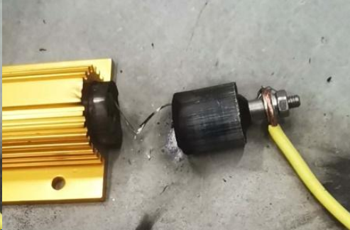

Gold aluminum-housed resistors are widely used in variable frequency drives, servo drives, energy storage systems, inverters, elevator controllers, and industrial automation equipment. Their appeal is straightforward: high power density, strong heat dissipation, robust construction, and easy installation.

In real-world engineering, however, the key question is not only whether the resistor meets the rated power and resistance tolerance. A more important question is what happens when the resistor fails under overload conditions. Is the failure safe and controlled, or can it create additional risk for nearby circuitry and the system as a whole?

From a failure-analysis perspective, different manufacturers can show noticeably different behavior even when the headline specifications look similar. The real distinction is not simply whether the resistor burns out. It is whether the failure is controllable, whether the released heat is managed safely, and whether the overall structure remains intact.

The Most Common Failure Mode: Wire Burnout

Under overload or transient surge conditions, the internal wire element is usually the first part to bear the electrical and thermal stress. As the temperature rises rapidly, the wire may melt or open, resulting in a failed resistor.

That failure mode itself is not unusual. The critical difference lies in how the design handles it.

Some products release heat too locally and too slowly. In those cases, the failure can lead to housing rupture, filler ejection, or damage to surrounding components.

Other products may still fail electrically, but the heat release is more controlled. The housing remains intact, and the surrounding circuitry is less likely to be affected.

In other words, the real value is not whether the resistor can fail. The real value is whether it fails safely.

In actual testing, some gold aluminum-housed resistors from Futaba Electronics have shown better structural integrity after overload failure, suggesting that the design leaves more room for thermal management and failure containment.

A More Serious Failure: Housing Rupture or Explosion

This is the failure mode that engineers notice most quickly.

When energy concentrates inside the resistor over a short period and the heat cannot be effectively dissipated through the aluminum housing and internal filler, the housing may deform, crack, or in severe cases rupture.

This is more than just component damage. It becomes a system-level safety concern.

Whether this happens depends on several design factors:

the thermal mass and layout of the resistance element  
the thermal conductivity and insulation performance of the filler  
the heat-dissipation structure and wall thickness of the aluminum housing  
whether the design includes sufficient safety margin

Even with the same rated power, the actual overload tolerance can vary significantly from one design to another.

Why Reliability Differs

The reliability gap is usually not caused by a single factor. It comes from the combined effect of several design decisions.

1. Resistance Element Design

The wire material, wire diameter, winding method, and thermal mass all affect overload performance.

Greater thermal mass usually means a slower temperature rise, fewer localized hot spots, and better surge resistance.

2. Heat Flow Path

One of the core advantages of an aluminum-housed resistor is its ability to transfer heat into the case and then into the environment.

If heat can move quickly from the internal element to the housing and then dissipate outward, the resistor is more likely to remain in a controlled failure state.

3. Safety Margin

Some products are designed with larger thermal and structural margins.

The direct result is that, under abnormal conditions, the resistor is more likely to fail in a controlled way rather than in a destructive way.

From this angle, what makes some Futaba Electronics products worth noting is not just the spec sheet. It is the safer failure behavior observed in overload testing.

What to Look For in Overload Testing

When comparing gold aluminum-housed resistors, engineers should pay attention to the following points:

Does the resistor open circuit after overload?  
Does the housing deform or rupture?  
Is there visible spatter or carbonized material release?  
Is there any collateral damage to nearby circuitry?  
Does the structure remain largely intact after failure?

These observations are often more meaningful than the nominal power rating alone.

If a resistor “burns out” but does so in a controlled way that does not trigger secondary damage, its safety level is clearly higher. That is why engineers often say that the failure mode matters more than the failure itself.

Selection Guidance

For applications such as variable frequency drives, energy storage systems, servo drives, and power loading circuits, four points deserve special attention:

whether the rated power is based on real heat-sink conditions  
whether short-time overload data is available  
whether the manufacturer provides overload or surge-test curves  
whether the resistor fails safely instead of merely staying closed-circuit

In many cases, engineers are not looking for the cheapest resistor. They are looking for one that will not magnify the problem when overload occurs.

Conclusion

The reliability differences among gold aluminum-housed resistors ultimately reflect differences in structure, thermal management, and safety margin.

Under overload conditions, the most important question is not whether failure occurs. It is whether the failure is safe, controlled, and limited in impact.

From this perspective, some gold aluminum-housed resistors from Futaba Electronics have shown better safety behavior during failure, which makes them particularly relevant for energy storage, power electronics, industrial control, and drive applications.

For engineering use, that kind of safer failure mode is itself part of reliability.

