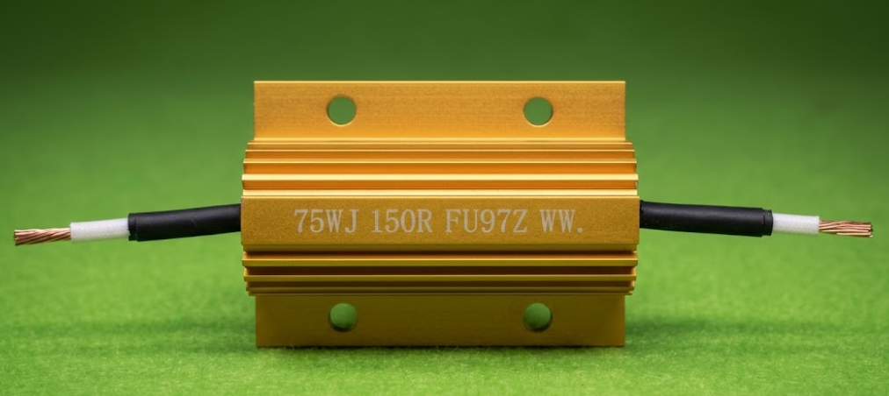
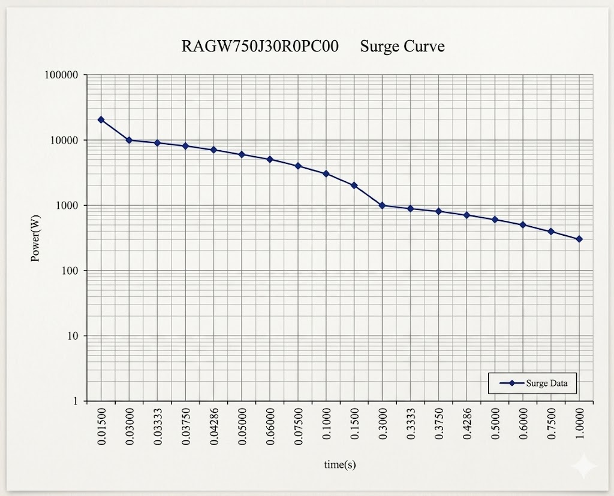

Abstract

In variable frequency drives, energy storage systems, and industrial drive equipment, aluminum housed power resistors do not function as “steady-state resistors,” but rather as critical energy dissipation and protection components.

Under complex operating conditions such as regenerative braking, surge impact, and frequent start-stop cycles, the resistor is not challenged by rated power, but by the combined requirements of transient surge capability and long-term thermal reliability.

This article provides a systematic engineering analysis of the “gold series aluminum housed resistor,” including surge capability, overload performance, and thermal characteristics, and explains the engineering advantages of FUTABA’s structural and material design in high-stress applications.

1. Executive Summary

The gold series aluminum housed resistor is essentially an engineering-optimized grade of aluminum housed power resistor (Aluminum Housed Power Resistor). Its core value does not lie in resistance accuracy, but in three key aspects:

Transient surge energy absorption capability  
Continuous overload power handling capability  
Structural stability under high-temperature conditions

The differentiation of FUTABA in this product line is mainly reflected in two engineering optimizations:

Improved thermal margin of structure and encapsulation materials  
Optimized thermo-mechanical coupling stability under surge and overload conditions

2. Industry Background: Why “Gold Series” Aluminum Resistors Exist

In industrial applications such as VFDs, energy storage systems, braking units, elevators, and inverters, resistors rarely operate under steady-state conditions. Instead, they frequently face the following scenarios:

Regenerative braking → sudden high energy absorption  
Motor start/stop → repeated surge current  
Power supply surge → transient high power spikes  
Long-term high-temperature operation → continuous thermal stress

Therefore, the core challenge of aluminum housed resistors is:

How to simultaneously improve transient energy absorption capability and long-term thermal reliability within a limited volume.

3. Core Technical Analysis: Surge Capability, Overload Behavior, and Thermal Failure Mechanisms  
    3.1 Surge Capability: Why Transient Conditions Matter More Than Rated Power

The essence of surge capability is the ability of a resistor to absorb energy beyond its rated power for a short duration. The key influencing factors include:

Thermal capacity of the resistive wire (heating rate)  
Thermal shock resistance of the substrate  
Thermal conductivity and expansion coefficient of potting materials  
Heat dissipation capability of the aluminum housing  
Engineering advantage of FUTABA:

Through optimized thermal path design, heat is transferred more efficiently to the aluminum housing surface. Local hotspots are effectively suppressed, reducing the risk of wire burnout. Combined with higher temperature-resistant material systems, overall surge capability is significantly improved.

3.2 Overload Capability: Two Primary Engineering Failure Modes

Overload failures are mainly dominated by the following two modes:

Failure Mode Root Cause  
Resistive wire burnout Local overheating  
Encapsulation cracking Thermal stress concentration  
FUTABA optimization approach:

By improving the thermal rating of the encapsulation system and optimizing the thermal expansion compatibility between materials, these failure risks are significantly reduced.

3.3 Thermal Performance: The Key Variable for Long-Term Reliability

The long-term reliability of gold series aluminum housed resistors is primarily determined by:

Thermal stability of potting materials  
Heat dissipation efficiency of the aluminum housing  
Stability of resistive wire under high temperature

The “higher thermal rating” emphasized by FUTABA means that the product can withstand higher overload energy stress, providing greater design safety margin for customers.

4. Typical Applications

Gold series aluminum housed resistors are widely used in:

VFD braking units (Braking Resistor)  
Photovoltaic inverters  
Energy storage PCS systems  
Elevator drive systems  
Servo drive systems  
Industrial surge absorption circuits  
Automotive power systems  
Core function summary:

Converting uncontrollable transient electrical energy into a controllable thermal dissipation process.

5. FUTABA Differentiation Analysis: Structural, Performance, and Application Advantages  
    5.1 Structural Advantages

Optimized heat dissipation path in aluminum housing, improved temperature resistance of encapsulation materials, and more stable thermal stress control.

5.2 Performance Advantages

Higher surge energy handling capability, ability to withstand stronger pulse conditions, provision of pulse energy reference values for customer selection, and significantly reduced failure probability.

5.3 Application Advantages

Better adaptability to high-frequency surge conditions, more suitable for high-density energy storage and inverter applications, and support for engineering-based customer selection under real operating conditions.

6. Conclusion: Why System-Level Reliability Matters More Than Rated Power

The core competitiveness of gold series aluminum housed resistors is not their static rated power, but:

Their system-level capability to withstand surge energy, thermal cycling, and long-term high-temperature conditions in real operating environments.

FUTABA’s key differentiation can be summarized as:

Stronger thermal structural stability  
Higher overload safety margin and surge resistance capability  
Better engineering reliability for complex operating conditions
