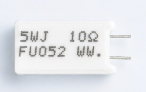

# Application and Reliability Evaluation of Cement Resistors in Energy Storage System Pre-Charge Circuits

In energy storage systems (PCS / commercial & industrial energy storage cabinets / PV-storage integrated systems), the DC bus energization process is always a critical risk point. Especially in high-capacitance DC-link scenarios, if a proper pre-charge path is not provided, extremely high inrush current will occur at startup, creating significant electrical stress on contactors, capacitors, and power devices. Therefore, the pre-charge resistor becomes a key but often underestimated component in energy storage systems.

* * *

## 1\. Core Issue in Energy Storage Pre-Charge: Not Power, but Impact Energy Evaluation

In energy storage system design, the selection of pre-charge resistors has long relied on empirical methods.

The most commonly used approaches are:

- Rated power-based selection
- Using “overload multiples” as a short-term capability reference

Typical descriptions include 6.25× overload, 10× overload.

While these methods provide some reference in scenarios where accurate assessment of resistor surge capability is difficult, their limitations are becoming increasingly evident with the rapid development of energy storage systems.

The key issue is:

Overload multiples cannot fully reflect the energy-handling capability of a resistor during the pre-charge process.

The reasons include:

- Overload multiples are only related to rated power and cannot reflect actual surge capability
- Different resistor structures exhibit completely different thermal paths under the same “multiple” condition

Therefore, in energy storage pre-charge applications, a more appropriate evaluation method should return to a fundamental parameter:

**Surge Energy (Joule Energy) Withstand Capability**

This refers to the energy boundary absorbed and dissipated by the resistor during real capacitor charging processes, rather than a simple power multiplier.

* * *

## 2\. Engineering Suitability of Cement Resistors in Pre-Charge Circuits

Among various power resistor structures, cement resistors offer clear engineering advantages in pre-charge applications due to their material and structural characteristics.

### Transient surge energy absorption capability

Cement resistors use a ceramic substrate and filling structure, providing relatively high thermal capacity. They can absorb large amounts of surge energy in a short time without structural damage. This short-term energy buffering capability is particularly important in typical energy storage pre-charge processes.

### Relatively safe failure mode

Under overload or abnormal surge conditions, cement resistors typically fail in an open-circuit mode rather than a short-circuit mode. This is critical in energy storage systems, as it helps reduce cascading system failures.

### Strong environmental and installation adaptability

Cement resistors have a stable structure and strong resistance to mechanical stress and thermal cycling. Their ceramic surface also provides good insulation performance.

* * *

## 3\. Pre-Charge Resistor Evaluation System Is Shifting from “Overload Multiples” to “Energy Models”

As energy storage systems continue to increase in power density, the industry is gradually realizing that traditional overload-multiple-based selection methods are no longer sufficient for design accuracy.

More engineering-oriented evaluation dimensions are emerging, including:

### Surge energy withstand capability (core metric)

The total energy (J) a resistor can withstand during a typical DC-link charging process.

### Repetitive pre-charge endurance

Performance stability after multiple power-on cycles.

### Controllability of failure mode

Whether the resistor maintains an open-circuit failure mode, avoiding system-level risk propagation.

Compared with a single overload multiple metric, this energy-based model is closer to real engineering conditions.

* * *

## 4\. Design Logic of Cement Resistors for Energy Storage Applications

In pre-charge applications, the design focus of cement resistors is not increasing rated power, but controlling the surge energy path.

Key design directions include:

### Surge energy design

Optimizing structure and materials to enhance transient energy handling capability.

### Batch consistency control

Ensuring consistent surge response so that design parameters can be engineered and modeled, rather than relying on empirical selection.

* * *

## 5\. Engineering Positioning of FUTABA Cement Resistors in Energy Storage Pre-Charge Applications

In energy storage pre-charge circuits, cement resistors are not only current-limiting components but also transient energy control units.

For energy storage applications, FUTABA cement resistors focus on the following engineering capabilities:

- High-surge pre-charge energy handling design
- Stability under repeated pre-charge cycles
- Controlled failure behavior under abnormal overload conditions
- Repeatable test and evaluation methodology

Compared with traditional selection logic centered on “rated power,” this approach is more aligned with real energy storage operating conditions.

* * *

## Conclusion

Although pre-charge resistors in energy storage systems are simple in structure, they serve as a critical safety boundary during system power-up.

With increasing energy density and reliability requirements, selection methods based solely on “power rating” or “overload multiples” are gradually being replaced by more engineering-oriented “surge energy evaluation models.”

Cement resistors, with their structural stability and energy absorption capability, still hold clear engineering value in this application and play an important role in energy storage system reliability design.

👉 Get Technical Support

👉 Contact Engineer

👉 Request a Quote

Click below to visit our official website:

[https://www.futabacn.com](https://www.futabacn.com/)
