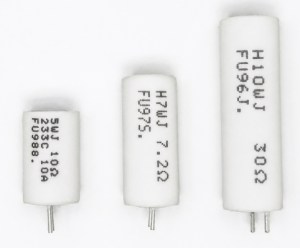

# Pre-charge and DC-Link Discharge Resistor Selection Guide for Energy Storage PCS: Why High Precision Is Not Always the Top Priority

In energy storage PCS systems, photovoltaic inverters, high-voltage variable frequency drives, and industrial power supplies, the DC-link pre-charge circuit and discharge circuit are critical components for ensuring system safety and reliability.

However, during FAE technical support and discussions with customers, we often find that some hardware engineers apply the same design mindset used for small-signal or precision measurement circuits when selecting these resistors.

They often prioritize:

- ±1% high resistance accuracy
- ≤50 ppm/°C low temperature coefficient of resistance (TCR)

These specifications are extremely important in precision measurement, current sensing, and feedback control applications.

However, for pre-charge and discharge circuits, which are typical high-energy transient applications, these parameters are usually not the primary design considerations.

Excessive focus on resistance accuracy and low TCR may increase BOM cost while causing engineers to overlook the factors that truly determine reliability:

- Transient energy withstand capability
- Thermal management capability
- Mechanical and structural reliability

This article explains the correct selection principles for high-power pre-charge and discharge resistors based on circuit operating conditions.

* * *

# 1\. What Are the Real Requirements of Pre-Charge and Discharge Circuits?

Before selecting a resistor, it is important to understand the actual purpose of these circuits.

## 1.1 Pre-charge Circuit

Before the main contactor closes, the pre-charge resistor limits the initial inrush current and gradually charges the DC-link capacitors.

The main objectives are:

- Limiting startup surge current
- Protecting contactors, capacitors, and power semiconductor devices
- Preventing excessive current stress during system startup

## 1.2 DC-Link Discharge Circuit (Bleeder Circuit)

After system shutdown or fault conditions, the discharge resistor releases the residual energy stored in the DC-link capacitors and reduces the voltage to a safe level.

The main objectives are:

- Reducing electric shock risk during maintenance
- Meeting safety requirements
- Shortening the discharge time after shutdown

Therefore, the key function of these resistors is:

**Reliable energy transfer, rather than precise voltage or current regulation.**

* * *

# 2\. Why Resistance Accuracy and TCR Are Usually Not the First Priority

## 2.1 Resistance Accuracy Has Limited Influence on System Function

Take a typical pre-charge resistor as an example.

Assume:

- Nominal resistance: 100Ω
- Resistance tolerance: ±5%

Actual resistance range:

95Ω to 105Ω

Compared with:

±1% tolerance:

99Ω to 101Ω

The resistance variation will affect the RC time constant. However, in most pre-charge systems, this variation can be compensated through design margins and control strategies without significantly affecting system operation.

Therefore, in energy transfer circuits:

Resistance accuracy is usually not the first priority.

Engineers should pay more attention to:

- Pulse energy capability
- Transient power capability
- Thermal capacity
- Structural reliability

* * *

## 2.2 TCR Influence Is Usually Lower Than Thermal Stress

The temperature coefficient of resistance (TCR) describes the resistance change caused by temperature variation.

For example:

50 ppm/°C means that:

A 100°C temperature increase causes approximately 0.5% resistance change.

This parameter is critical for precision circuits requiring long-term stability.

However, in pre-charge and discharge applications:

- The operating time is usually short
- The main challenge is transient thermal stress
- The resistor must survive high-energy pulses

Therefore:

**Pulse reliability should be considered before resistance accuracy and TCR in high-energy transient applications.**

* * *

# 3\. The Key Parameter: Energy Withstand Capability

Many engineers focus mainly on:

- Rated power (W)

However, for pre-charge and discharge applications, more important parameters are:

- Single pulse energy capability (Joule)
- Short-time overload capability
- Thermal capacity

The reason is that these circuits typically involve:

- Short duration
- High instantaneous power
- Insufficient time for heat dissipation

This is a typical transient thermal stress condition.

The theoretical energy stored in a capacitor is:

E=12CV2E=\\frac{1}{2}CV^2E\=21​CV2

Where:

- C = Total DC-link capacitance
- V = DC-link voltage

Example:

An energy storage system:

- DC-link voltage: 800V
- Capacitance: 5mF

The stored energy is:

E=12×0.005×8002E=\\frac{1}{2}\\times0.005\\times800^2E\=21​×0.005×8002

Approximately:

**1600J**

This energy is equivalent to the energy generated by a 100W load operating continuously for about 16 seconds.

Therefore, the pre-charge resistor must have sufficient transient energy absorption capability.

It should be noted that:

12CV2\\frac{1}{2}CV^221​CV2

represents the theoretical maximum energy stored in the capacitor.

The actual energy absorbed by the resistor depends on:

- Power source impedance
- Pre-charge resistance value
- Charging time
- Control strategy

Therefore, final resistor selection should be verified based on actual system parameters and testing.

* * *

# 4\. Why Ordinary Precision Resistors May Not Be Suitable for High-Energy Pulses

High-precision thin-film resistors and conventional metal film resistors have advantages such as:

- High resistance accuracy
- Low TCR
- Excellent long-term stability

However, their internal conductive layers are relatively thin.

When exposed to high-energy pulses, they may experience:

- Localized heating
- Thermal stress
- Film damage

Therefore, ordinary precision resistors are generally not suitable for high-energy pre-charge and discharge applications.

This does not mean all thin-film resistors are unsuitable for pulse applications.

However:

**For high-energy transient conditions, resistors specifically designed for pulse withstand capability should be selected.**

* * *

# 5\. Recommended Resistor Structures for High-Power Pre-Charge and Discharge Applications

## 5.1 Wirewound Power Resistors: Common Solution for High-Energy Applications

Wirewound resistors typically use:

- Nickel-chromium alloy wire
- Constantan alloy wire
- Ceramic core structures

Advantages include:

- High thermal capacity
- Effective heat distribution
- Better energy absorption capability

Typical applications:

- Energy storage pre-charge circuits
- Inverter startup protection
- Industrial power supply surge absorption

* * *

## 5.2 Cement Power Resistors: Cost-Effective Industrial Solution

Cement resistors typically use:

- Ceramic housing
- Inorganic filling materials

Advantages:

- High temperature resistance
- Good vibration resistance
- Strong environmental durability

Applications:

- Industrial power supplies
- Variable frequency drives
- Automation equipment

* * *

## 5.3 Aluminum Housing Power Resistors: Continuous Discharge Applications

Aluminum housing resistors improve thermal management through:

- Aluminum alloy housing heat dissipation
- Thermal conductive filling materials
- Optimized internal structures

Applications:

- Energy storage PCS
- High-voltage drives
- High-power electrical systems

* * *

# 6\. FUTABA High-Pulse Power Resistor Solutions

As a manufacturer specializing in power resistors, FUTABA provides various resistor solutions for renewable energy, power electronics, and industrial applications.

Examples include:

## High-Pulse Wirewound Resistors (HVW / HVX Series)

Designed for:

- High transient energy applications
- Pulse reliability
- Insulation protection

Applications:

- Pre-charge circuits
- Surge absorption
- Discharge protection

## Cement Power Resistors (RGW / RGK Series)

Features:

- High thermal capacity
- Good environmental reliability
- Cost advantages

## Aluminum Housing Power Resistors (RAMH / RAMS / RASQ Series)

Suitable for:

- Continuous discharge
- High-power operation
- Applications requiring enhanced thermal management

Final selection should consider:

- Resistance value
- Pulse duration
- Energy waveform
- Installation conditions

* * *

# 7\. Summary: How to Select Pre-Charge and Discharge Resistors

For energy storage PCS, photovoltaic inverters, and high-voltage drives, engineers should follow these principles:

## 1\. Do Not Prioritize Precision Specifications First

For energy-handling applications:

±5% or even wider resistance tolerance may be sufficient for many system designs.

The design focus should be:

- Pulse capability
- Safety margin
- Structural reliability

* * *

## 2\. Calculate Energy Before Selecting the Resistor

Use:

E=12CV2E=\\frac12CV^2E\=21​CV2

to estimate the energy level.

Also consider:

- Single pulse events
- Repetition frequency
- Cooling conditions

* * *

## 3\. Select the Appropriate Resistor Structure

Typical selection:

- High-energy transient → High-pulse wirewound resistor
- General industrial applications → Cement power resistor
- Continuous discharge → Aluminum housing power resistor

The ultimate goal is not selecting the resistor with the highest specifications, but selecting the resistor that can provide:

**Reliable long-term operation under actual application conditions.**

For renewable energy and industrial power systems, resistors may represent a relatively small portion of total BOM cost, but resistor failure can directly cause system downtime. Therefore, reliability-oriented design is often more important than simply pursuing better specifications.

