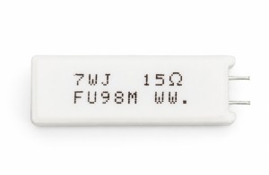

## Introduction: The Hidden Failure Risk in Servo Drive Power Systems

In the development of servo drives and industrial inverter systems, engineers often encounter a hidden reliability issue:

The equipment operates normally during regular operation, but during frequent power cycling, repeated startup sequences, or simultaneous power-on of multiple devices, unexpected failures occur — such as upstream fuse blowing, rectifier bridge damage, or even open-circuit failure of the pre-charge resistor.

During troubleshooting, engineers often focus on control logic, relay timing, or software protection strategies. However, the root cause is sometimes hidden in the simplest passive component in the pre-charge circuit — the **pre-charge resistor**.

As industrial automation equipment continues to move toward higher power density and smaller form factors, the available space for power components is becoming increasingly limited. Compact power resistor packages, typically in the range of **5W–20W**, are widely used in servo drives.

The key challenge is:

**How can a compact pre-charge resistor reliably withstand repeated high-energy startup pulses within a limited physical size?**

This capability directly affects the startup reliability and lifetime performance of the entire drive system.

* * *

# 1\. What Does a Pre-charge Resistor Experience During Servo Drive Startup?

A typical servo drive main power circuit consists of:

- AC rectifier stage
- DC-Link capacitor bank
- Inverter stage (IGBT / MOSFET)

To achieve high dynamic response and rapid torque control, servo systems usually require a large DC-Link capacitor bank, including electrolytic capacitors or film capacitors.

At the moment of power-on, the DC-Link capacitor is initially discharged and behaves almost like a short circuit.

Without current limitation, a very large **inrush current** would flow directly through:

- the rectifier module,
- input fuse,
- power supply network,
- and switching devices.

The function of the pre-charge resistor is to limit this initial current surge.

During startup:

1. The pre-charge resistor is connected in series with the DC-Link charging path.
2. The capacitor voltage gradually increases.
3. After reaching the designed voltage threshold, a relay, contactor, or semiconductor switch bypasses the resistor.
4. Normal operation begins.

The operating characteristics of a pre-charge resistor are very different from a conventional power resistor.

### Typical characteristics:

- **Short operating duration:**  
    Usually from several milliseconds to several seconds.
- **High instantaneous power:**  
    Peak pulse power can be hundreds of times higher than the rated continuous power.
- **Fixed energy absorption requirement:**  
    The absorbed energy mainly depends on the DC-Link capacitance and voltage.

The charging energy can be calculated by:

E=12CV2E=\\frac{1}{2}CV^2E\=21​CV2

Where:

- **E** = stored energy absorbed by the resistor (Joule)
- **C** = total DC-Link capacitance (F)
- **V** = DC-Link voltage (V)

For example, increasing DC-Link voltage from 400V to 800V does not simply double the energy requirement. Since energy is proportional to the square of voltage, the required pulse energy increases significantly.

This is why higher-voltage industrial systems and next-generation high-power architectures place greater demands on pre-charge resistor performance.

* * *

# 2\. Why Do Same-rated Power Resistors Have Different Pulse Capabilities?

A common mistake in resistor selection is focusing only on the rated continuous power.

For example:

A design calculation may show that the average pre-charge power consumption is relatively low, so engineers select a standard **10W cement resistor**.

However, during actual reliability testing:

- Resistor A with a 10W rating and the same physical size survives repeated startup cycles.
- Resistor B with identical dimensions experiences resistance drift or open failure after multiple pulse events.

Why?

Because:

**Continuous power rating defines steady-state thermal performance, while pulse capability depends on thermal mass, internal construction, and energy distribution.**

During a short-duration pulse:

- Electrical energy is rapidly converted into heat.
- Heat is initially stored inside the resistor element and nearby materials.
- Heat dissipation to the environment is relatively slow.

If the internal structure is not optimized, localized heating occurs.

This creates a **hot spot** inside the resistance wire.

The consequences include:

- excessive local temperature rise,
- thermal expansion stress,
- resistance wire degradation,
- ceramic cracking,
- coating micro-fractures,
- eventual open-circuit failure.

Therefore, two resistors with identical:

- rated power,
- dimensions,
- resistance value,

may have completely different real-world pulse endurance.

* * *

# 3\. Key Factors Affecting Cement Resistor Pulse Capability Under the Same Size Constraint

For compact servo drives, simply increasing resistor size is often impossible.

Improving transient pulse capability within the same package requires optimization of internal engineering factors.

* * *

## 3.1 Resistance Element Design and Wire Diameter Control

For wire-wound cement resistors commonly used in pre-charge applications, such as the RGW series, pulse performance starts from the design of the resistance element.

The key factors include:

- alloy resistance wire selection,
- wire diameter optimization,
- winding pitch control,
- current density distribution.

Under the same resistance value, increasing wire diameter appropriately and optimizing the winding structure can:

- reduce local current density,
- distribute heat more evenly,
- reduce hot spot formation,
- improve pulse energy endurance.

The goal is not simply to increase resistance wire length, but to achieve a more uniform thermal and electrical stress distribution.

* * *

## 3.2 Thermal Matching of Filling Materials

The internal ceramic filling compound in a cement resistor performs multiple functions:

- fixing the resistance element,
- transferring heat,
- providing electrical insulation,
- protecting against mechanical stress.

High-performance filling systems require:

- good thermal conductivity,
- high temperature stability,
- compatible thermal expansion characteristics.

The thermal expansion coefficient (**CTE: Coefficient of Thermal Expansion**) between:

- ceramic core,
- resistance wire,
- filling material,
- external coating,

must be carefully controlled.

During repeated startup cycles, mismatched thermal expansion can generate mechanical stress, causing:

- internal cracks,
- interface separation,
- insulation degradation.

Therefore, material matching is a critical factor in long-term pulse reliability.

4\. FUTABA RGW Series Design Adaptation for Servo Drive Pre-charge Applications

For servo drives, industrial inverters, and power conversion equipment, the challenge is not only achieving high pulse capability, but achieving it within increasingly limited installation space.

As a manufacturer specializing in power resistor technology, FUTABA has optimized the RGW series wire-wound cement resistor to address the requirements of compact size, high pulse energy absorption, and long-term reliability in pre-charge applications.

The main design considerations include:

4.1 Optimized Resistance Element and Packaging Structure

Maintaining the standard external dimensions, improvements in:

resistance element design,

wire winding process,

thermal structure,

filling material system,

help enhance the transient energy capability per unit volume.

This allows the resistor to handle repeated startup pulses while maintaining stable electrical performance.

For servo drive applications where PCB space and mechanical constraints are critical, improving energy density without increasing package size provides greater design flexibility.

4.2 Reliability Verification Under Pulse Stress Conditions

Traditional power resistor evaluation often focuses on:

rated power,

resistance tolerance,

temperature rise.

However, pre-charge applications require additional validation focused on transient conditions.

Relevant evaluation items include:

millisecond-level pulse endurance,

second-level overload capability,

repeated startup cycle testing,

resistance stability after pulse loading.

The basic reliability evaluation references relevant requirements from:

JIS C 5201-1 (Fixed Resistors for Use in Electronic Equipment — General Specification)

while additional pulse verification is performed based on actual servo drive application conditions.

The objective is to ensure that the resistor performance matches real-world operating requirements rather than only laboratory continuous-power specifications.

4.3 Manufacturing Consistency for High-volume Applications

For industrial equipment manufacturers, reliability is not only determined by individual sample performance.

Batch-to-batch consistency is equally important.

Key controlled materials include:

ceramic cores,

alloy resistance wire,

insulation materials,

cement filling compounds.

Strict process control helps ensure:

stable resistance values,

consistent pulse performance,

predictable lifetime behavior under repeated startup conditions.

For high-volume servo drives, industrial robots, and automation equipment, manufacturing consistency directly affects field reliability and maintenance costs.

5\. Pre-charge Resistor Selection Guide for Servo Drives

To avoid unexpected failures in pre-charge circuits, engineers should evaluate the resistor based on actual pulse energy requirements rather than only rated power.

A practical selection process includes the following steps.

Step 1: Calculate Single Startup Pulse Energy

Calculate the energy stored in the DC-Link capacitor:

E\=21​CV2

Where:

E = required pulse energy absorption (J)

C = total DC-Link capacitance (F)

V = DC-Link voltage (V)

The resistor must be capable of absorbing this energy without excessive temperature rise or structural damage.

Step 2: Evaluate Pre-charge Time and Peak Current

Theoretical charging time can be estimated using the RC time constant:

τ=RC

However, actual system behavior depends on:

DC-Link voltage target,

allowable charging time,

relay/contact timing,

control strategy,

input power conditions.

The resistor value must balance:

sufficient current limitation,

acceptable charging speed,

manageable resistor stress.

Step 3: Check Pulse Energy Capability Data

Engineers should review manufacturer-provided information such as:

pulse overload curves,

Joule energy ratings,

short-time overload capability,

repetitive pulse test data.

The selected resistor should provide sufficient margin beyond the calculated startup energy.

A resistor that barely meets the theoretical value may fail under real-world conditions due to:

temperature accumulation,

repeated startup cycles,

environmental temperature variation.

Step 4: Consider Frequent Power Cycling Conditions

Many industrial applications experience frequent startup events, including:

CNC machines,

robotic systems,

automated production lines,

semiconductor equipment.

Under these conditions, the resistor does not completely return to ambient temperature between cycles.

Therefore, engineers should consider:

thermal accumulation,

duty cycle,

cooling conditions,

required lifetime.

A sufficient pulse margin is essential for long-term reliability.

Conclusion: Transient Capability Is the Real Benchmark for Pre-charge Resistor Selection

As servo drives and industrial power systems continue moving toward higher power density, the pre-charge resistor remains a small but critical component.

Although it represents only a minor part of the overall system cost, its performance directly affects:

startup reliability,

protection circuit lifetime,

field failure rate,

maintenance cost.

When selecting a pre-charge resistor, engineers should not judge performance only by:

rated wattage,

package size,

resistance value.

The more important factors are:

pulse energy capability (Joule rating),

thermal mass,

internal resistance element design,

material thermal compatibility,

repetitive startup endurance.

For compact servo drives, choosing a cement resistor with higher transient pulse capability within the same physical dimensions can significantly improve system reliability and reduce failures caused by inrush current stress.

A well-designed pre-charge resistor is not simply a heat-generating component — it is a critical energy management element that protects the entire power conversion system during every startup event.

