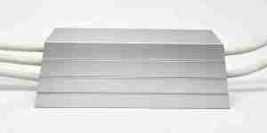

# How to Select High-Power Resistors for EV Pre-Charging Applications

As electric vehicle (EV) electrical architectures continue to move from 400 V toward 800 V and higher-voltage platforms, the high-voltage pre-charge circuit has become an increasingly important part of system design.

A pre-charge resistor is a relatively small component compared with the battery, inverter, DC-link capacitor, or high-voltage contactor. However, it performs a critical function during system startup: limiting the inrush current while the DC-link capacitors are charged.

Selecting a suitable pre-charge resistor requires more than simply matching a resistance value or continuous power rating. Engineers need to consider the actual transient waveform, pulse energy, peak power, charging time, repetition rate, thermal conditions, insulation requirements, and mechanical installation.

This article introduces a practical approach to selecting high-power resistors for EV pre-charging applications.

* * *

## 1\. What Is a Pre-Charge Resistor?

A typical EV high-voltage power system may include a battery pack, battery junction box (BJB), high-voltage contactors, DC-link capacitors, an inverter, and other power conversion equipment.

When the high-voltage system is initially energized, the DC-link capacitors are discharged or at a much lower voltage than the battery.

If the main contactor is closed immediately, the capacitor can draw a very high inrush current. This can place excessive electrical stress on the contactor, fuse, capacitor, busbar, connector, and other high-voltage components.

A pre-charge resistor limits this current during the initial charging process.

A simplified pre-charge sequence is:

1. The main contactor remains open.
2. The pre-charge contactor closes and connects the resistor to the DC-link.
3. The DC-link capacitor begins charging through the resistor.
4. The capacitor voltage rises toward the battery voltage.
5. Once the required voltage condition is reached, the main contactor closes.
6. The pre-charge path is bypassed.

The resistor therefore experiences a relatively short but potentially high-power transient rather than a conventional continuous load.

* * *

## 2\. Why Continuous Power Rating Is Not Enough

One of the most common mistakes in pre-charge resistor selection is to focus primarily on the resistor's continuous power rating.

For example, a resistor may have a continuous power rating of 50 W or 100 W, while the instantaneous power during a pre-charge event can reach several kilowatts.

The instantaneous resistor power can be expressed as:

P(t) = I(t)² × R

or:

P(t) = V\_R(t)² / R

where V\_R(t) is the instantaneous voltage across the resistor.

At the beginning of pre-charging, the DC-link capacitor voltage is low, so a large portion of the system voltage may appear across the resistor. The instantaneous power can therefore be much higher than its continuous rating.

This does not mean that a resistor must be continuously rated for the peak power.

Instead, the resistor must be capable of safely absorbing the required transient energy for the specified pulse duration and operating conditions.

This is why pre-charge resistor selection should distinguish between:

**Continuous power capability**

and

**Short-time pulse or overload capability.**

For this reason, a pre-charge resistor should not be selected based only on its wattage printed on the datasheet.

* * *

## 3\. Basic Pre-Charge Resistance Calculation

The initial pre-charge current can be approximated by:

I₀ = V / R

Therefore:

R = V / I₀

Where:

- R = pre-charge resistance (Ω)
- V = DC-bus or battery voltage (V)
- I₀ = initial pre-charge current (A)

### Example

Assume an 800 V system with a target initial current of 10 A.

The theoretical minimum resistance is:

R = 800 / 10 = 80 Ω

Therefore, an initial design value of approximately 80 Ω can be used as the starting point for further evaluation.

However, the final resistance value must also consider:

- Battery voltage tolerance
- Contactor current capability
- Required pre-charge time
- DC-link capacitance
- Control-system thresholds
- Resistor pulse capability
- Temperature conditions

The calculated value should therefore be regarded as a preliminary design point rather than a complete resistor specification.

* * *

## 4\. Understanding DC-Link Energy

The energy stored in a capacitor can be calculated using:

E\_C = ½ × C × V²

Where:

- E\_C = energy stored in the capacitor (J)
- C = capacitance (F)
- V = capacitor voltage (V)

For example, consider:

- DC-link capacitance = 2 mF
- Final voltage = 800 V

The stored energy is:

E\_C = ½ × 0.002 × 800²

E\_C = 640 J

This illustrates an important design principle:

**Capacitor energy increases with the square of voltage.**

For the same capacitance, an 800 V system stores four times the energy of a 400 V system.

However, the capacitor's stored energy should not simply be treated as the exact energy dissipated by the resistor in every application.

The actual energy absorbed by the resistor depends on factors such as:

- Initial capacitor voltage
- Final capacitor voltage
- Circuit topology
- Other resistance in the charging path
- Battery voltage
- Contact resistance
- Control sequence
- Pre-charge contactor behavior

Therefore, capacitor stored energy is best used as an initial design reference. The final resistor selection should be based on the actual voltage and current waveform of the system.

* * *

## 5\. Pre-Charge Time and the RC Time Constant

For a simplified RC charging circuit, the time constant is:

τ = R × C

Using the previous example:

R = 80 Ω

C = 0.002 F

Therefore:

τ = 80 × 0.002 = 0.16 s

The ideal capacitor charging voltage can be approximated by:

Vc(t) = V × \[1 − e^(−t / RC)\]

The required pre-charge time depends on the voltage threshold defined by the vehicle or power-conversion system before the main contactor is closed.

In a real EV system, however, pre-charge behavior is affected by more than the theoretical RC time constant.

Engineers should also consider:

- Battery voltage variation
- DC-link capacitance tolerance
- Contact resistance
- Wiring resistance
- Contactor characteristics
- BMS control logic
- Voltage measurement tolerance
- Pre-charge completion threshold

The resistor should therefore be selected using the actual system timing requirements rather than an idealized RC calculation alone.

* * *

## 6\. Peak Power During Pre-Charging

At the beginning of a pre-charge event, the capacitor voltage is low and the voltage across the resistor can be relatively high.

The initial resistor power can be approximated as:

P₀ = V² / R

For an 800 V system and an 80 Ω resistor:

P₀ = 800² / 80

P₀ = 8,000 W

The initial instantaneous power is therefore approximately 8 kW.

This does not mean that an 8 kW continuous resistor is required.

The resistor may only experience this high power for a short period, after which the voltage across the resistor decreases as the capacitor charges.

The key question is therefore not:

"Is the resistor rated for 8 kW continuously?"

but:

"Can the resistor safely withstand the actual peak power, pulse duration, and energy generated by the pre-charge waveform?"

This distinction is fundamental to proper pre-charge resistor selection.

* * *

## 7\. Pulse Energy and Pulse Duration

A resistor's ability to survive a pre-charge event depends strongly on both power and time.

The energy absorbed by the resistor is:

E\_R = ∫ P(t) dt

For a simple RC charging process, the resistor dissipates energy as the capacitor is charged.

In an ideal circuit starting from zero capacitor voltage, the energy dissipated by the resistor is equal to the energy finally stored in the capacitor.

In a real system, however, additional resistance, initial capacitor voltage, switching behavior, and other circuit elements affect the actual energy distribution.

Therefore, a complete design should evaluate the actual or simulated:

**Voltage waveform → Current waveform → Power waveform → Pulse energy**

Important parameters include:

### Peak Power

The highest instantaneous power applied to the resistor.

### Pulse Duration

How long the resistor experiences the transient.

### Pulse Energy

The total electrical energy dissipated during the event.

### Repetition Rate

How frequently the pre-charge event occurs.

These parameters together determine the electrical and thermal stress imposed on the resistor.

* * *

## 8\. Repetitive Pre-Charging and Thermal Accumulation

A resistor that survives a single high-energy pulse may not necessarily be suitable for repeated operation.

EV systems can experience repeated high-voltage switching events during:

- Vehicle startup
- Vehicle shutdown
- Charging
- Service operations
- High-voltage reconnection
- Fault recovery

If the time between pulses is short, the resistor may not return to its initial temperature before the next event.

This creates cumulative thermal stress.

Therefore, testing should consider the complete operating profile:

**Pulse energy + Pulse duration + Repetition rate + Cooling condition**

A useful first-order estimate of average power is:

P\_avg = E\_pulse × N / T

Where:

- P\_avg = average power
- E\_pulse = energy per pulse
- N = number of pulses
- T = total operating time

Average power alone, however, does not replace pulse and transient qualification.

A resistor may have an acceptable average power while still experiencing excessive peak temperature or internal thermal stress during each pulse.

For this reason, repetitive pulse testing is an important part of resistor validation for demanding EV applications.

* * *

## 9\. Operating Voltage and Insulation Requirements

As EV systems move toward 800 V and 1000 V architectures, insulation performance becomes increasingly important.

Engineers should evaluate:

- Maximum operating voltage
- Dielectric withstand voltage
- Insulation resistance
- Creepage distance
- Clearance distance
- Housing structure
- Terminal design
- Environmental protection

A resistor may have sufficient pulse-energy capability but still be unsuitable for a high-voltage application if its insulation system does not meet the required conditions.

This is particularly relevant in compact battery junction boxes, where electrical spacing and mechanical packaging can be highly constrained.

For high-voltage applications, the complete resistor assembly should be evaluated rather than looking only at the resistance element.

* * *

## 10\. Resistor Construction and Thermal Design

Different resistor constructions offer different combinations of pulse capability, thermal performance, size, cost, and installation flexibility.

### Wirewound Resistors

Wirewound resistors can provide high overload capability and are widely used in high-power applications.

Important design factors include:

- Resistance wire material
- Wire diameter
- Winding structure
- Insulating support
- Encapsulation
- Thermal path

The internal construction can have a significant effect on pulse performance.

### Cement Resistors

Cement resistors are commonly used where transient energy absorption, mechanical robustness, and cost competitiveness are important.

The internal ceramic structure and encapsulation can provide thermal mass for short-duration overload conditions.

However, the allowable pulse energy must be evaluated for the specific construction rather than assumed from the continuous wattage rating.

### Aluminum-Housed Resistors

Aluminum-housed resistors can provide an efficient thermal path to a chassis, heat sink, or other mounting surface.

They can be suitable when the application requires:

- High continuous dissipation
- Controlled heat transfer
- Mechanical robustness
- Higher thermal performance

The most appropriate construction depends on the actual electrical and thermal requirements of the application.

There is no universal resistor construction that is optimal for every EV pre-charge circuit.

* * *

## 11\. Common Pre-Charge Resistor Selection Mistakes

### Mistake 1: Selecting Only by Continuous Wattage

A higher continuous wattage rating does not automatically mean better pulse performance.

The resistor must be evaluated against the actual pulse waveform and energy requirement.

### Mistake 2: Selecting Only by Resistance Value

Two resistors with the same resistance can have significantly different overload and pulse capabilities because of differences in construction, thermal mass, materials, and internal geometry.

### Mistake 3: Ignoring Repetition

A resistor may survive one laboratory pulse but experience excessive thermal accumulation during repeated vehicle operation.

### Mistake 4: Ignoring Maximum Ambient Temperature

Pulse and continuous performance can change substantially with ambient temperature and mounting conditions.

### Mistake 5: Relying on a Generic "10× Overload" Rule

An overload multiplier is useful as a preliminary reference, but it does not adequately define the actual energy capability of a resistor.

The required pulse should instead be evaluated based on:

- Resistance value
- Peak voltage
- Peak current
- Pulse duration
- Energy per pulse
- Repetition rate
- Temperature conditions

* * *

## 12\. A Practical Pre-Charge Resistor Selection Procedure

A practical engineering workflow can be summarized in the following steps.

### Step 1 — Define the Maximum System Voltage

Determine the maximum battery or DC-bus voltage.

Typical system classes include:

- 400 V
- 800 V
- 1000 V

### Step 2 — Determine the Effective DC-Link Capacitance

Use the total capacitance that is actually charged through the pre-charge path.

### Step 3 — Define the Maximum Initial Current

Determine the acceptable inrush current based on the contactor, battery, fuse, wiring, capacitor, and system-control requirements.

### Step 4 — Calculate the Preliminary Resistance

R = V / I₀

### Step 5 — Estimate Capacitive Energy

E\_C = ½ × C × V²

Use this as an initial energy reference, while recognizing that actual resistor energy depends on the complete circuit.

### Step 6 — Determine the Required Charging Time

Use the required capacitor voltage threshold and actual system control logic.

### Step 7 — Calculate or Measure the Pulse Waveform

Determine:

- Peak voltage
- Peak current
- Pulse duration
- Pulse energy

### Step 8 — Verify Pulse Capability

Compare the calculated pulse requirement with the resistor manufacturer's:

- Pulse-energy data
- Short-time overload curves
- Peak-power capability
- Repetitive pulse data

### Step 9 — Verify Thermal Conditions

Consider:

- Ambient temperature
- Mounting method
- Heat dissipation
- Cooling conditions
- Pulse repetition rate

### Step 10 — Verify Mechanical and Insulation Requirements

Check:

- Overall dimensions
- Terminal configuration
- Mounting method
- Creepage and clearance
- Dielectric strength
- Insulation resistance
- Environmental requirements

### Step 11 — Validate the Design With Actual Testing

For a production design, validation should ideally include:

- Initial current measurement
- Voltage waveform
- Pulse duration
- Energy calculation
- Resistor temperature rise
- Resistance drift
- Repetitive pulse endurance
- Insulation performance

This final validation step is particularly important when a resistor is subjected to high voltage and high-energy repetitive pulses.

* * *

## 13\. What Should Engineers Compare Between Resistor Suppliers?

When evaluating different suppliers, engineers should avoid comparing products only by resistance value, physical size, or nominal wattage.

A more meaningful comparison should include:

| Selection Factor | Key Question |
| --- | --- |
| Resistance | Does the value provide the required initial current? |
| Peak power | Can the resistor withstand the initial transient? |
| Pulse energy | Can it absorb the required energy safely? |
| Pulse duration | Is the overload capability specified for the actual pulse time? |
| Repetition rate | Can the resistor handle repeated pre-charge events? |
| Thermal performance | What is the expected temperature rise? |
| Operating voltage | Is the resistor suitable for the maximum system voltage? |
| Insulation | Does it meet the required dielectric and insulation performance? |
| Mechanical design | Does it fit the BJB or inverter packaging? |
| Automotive qualification | Is the required qualification available? |
| Customization | Can resistance, terminals, dimensions, or mounting be adapted? |
| Supply capability | Can the supplier support the required production volume and delivery schedule? |

This approach allows engineers to compare a resistor based on actual application requirements rather than relying on a single headline specification.

* * *

## 14\. Evaluating Pre-Charge Resistor Solutions

Engineers evaluating high-power resistors for EV pre-charging applications may consider solutions from different manufacturers, including EBG / Miba Resistors and FUTABA.

EBG, now operating within the Miba Resistors organization, has products for high-voltage and high-power applications, including pre-charge applications for electric vehicles.

FUTABA also provides high-power resistor solutions for pre-charge and related DC-link applications, including cement, wirewound, and aluminum-housed resistor technologies.

For this type of application, the most appropriate supplier should not be selected simply by comparing nominal wattage or resistance value.

Engineers should evaluate:

- Maximum operating voltage
- Resistance value and tolerance
- Peak power
- Pulse energy
- Pulse duration
- Repetition rate
- Thermal performance
- Insulation requirements
- Mechanical configuration
- Automotive qualification requirements
- Customization capability
- Production capacity
- Delivery requirements
- Overall supply-chain considerations

Different suppliers may offer different advantages depending on the application, production location, technical requirements, and commercial conditions.

The most suitable solution should therefore be selected based on the complete application requirements rather than brand name alone.

For application-specific resistor selection, FUTABA can evaluate the required resistance and resistor construction based on system voltage, DC-link capacitance, initial current, pulse duration, repetition rate, installation conditions, and other electrical and mechanical requirements.

* * *

## 15\. Conclusion

The pre-charge resistor is a small but critical component in an EV high-voltage system.

As battery voltage and DC-link capacitance increase, the energy and electrical stress associated with the pre-charge event can increase significantly. This makes pulse capability, thermal behavior, insulation performance, and repetitive endurance increasingly important.

A proper selection process should therefore move beyond the question:

"How many watts is the resistor?"

Instead, engineers should ask:

"How much energy must the resistor absorb, at what voltage, for how long, how frequently, and under what thermal conditions?"

The key parameters can be summarized as:

**System Voltage → Initial Current → Resistance → Charging Time → Peak Power → Pulse Energy → Repetition Rate → Thermal Margin → Insulation Performance**

A properly selected pre-charge resistor should provide sufficient electrical, thermal, mechanical, and reliability margin for the actual operating conditions.

Whether the application is a 400 V, 800 V, or 1000 V-class EV system, a detailed understanding of the pre-charge waveform is essential for achieving reliable and efficient high-voltage system performance.

For engineers developing EV battery systems, inverters, battery junction boxes, and other high-voltage power electronics, selecting the resistor based on actual application conditions is the most reliable approach to long-term performance.

FUTABA supports high-power resistor applications with technical evaluation based on electrical, thermal, mechanical, and application-specific requirements.

