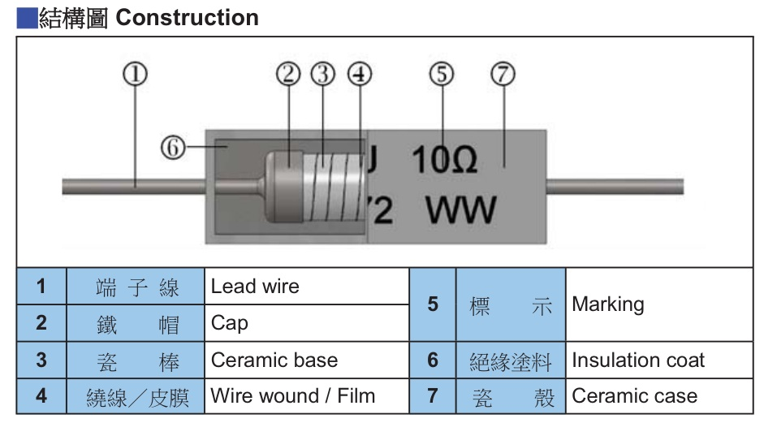

### FUTABA RG Cement Resistors: High-Performance Power Resistors for Industrial and Energy Applications

Cement resistors are a common type of power resistor used in power electronics and industrial control systems. They are widely used in energy storage systems, inverters, variable frequency drives, servo drives, power supplies, and new energy equipment for pre-charge, discharge, current limiting, and energy dissipation circuits.

FUTABA has long specialized in power resistor products and provides the RG series of cement resistors with different power ratings, resistance values, structures, and mounting configurations. FUTABA also provides engineering selection support for applications involving pulse loads, overloads, and other demanding operating conditions.

### 1\. Construction of FUTABA RG Cement Resistors

FUTABA RG cement resistors use a ceramic-based construction. A typical product consists of the following components:

**\[Insert RG Cement Resistor Construction Image Here\]**

| No. | Component |
| --- | --- |
| 1 | Leadwire |
| 2 | Cap |
| 3 | Ceramicbase |
| 4 | Wirewound/Film |
| 5 | Marking |
| 6 | Insulationcoat |
| 7 | Ceramiccase |

The resistance material determines the major electrical characteristics of the resistor, while the ceramic base, insulation coating, and ceramic case provide mechanical support, electrical insulation, and physical protection.

For a power resistor, performance is not determined by the resistance material alone. The overall construction, connection process, and thermal design can also have a significant influence on stability and load capability.

### 2\. RGW Wirewound and RGF Film-Type Cement Resistors

According to the resistance element structure, the FUTABA RG series mainly includes wirewound and film-type cement resistors.

### RGW — Wirewound Cement Resistors

Wirewound cement resistors mainly use a resistance wire wound around the ceramic base. They are generally used for lower resistance values and applications requiring higher transient load and pulse capability.

Typical applications include:

- DC-link pre-charge
- Capacitor discharge
- Dynamic braking
- Instantaneous current limiting
- Energy storage and inverter circuits

For applications involving high inrush current or short-duration high-energy loads, a wirewound structure is often an important option to consider.

### RGF — Film-Type Cement Resistors

Film-type cement resistors use film-based resistance materials such as metal oxide film and are mainly used for higher resistance values and general power-load applications.

For applications involving significant pulse or overload requirements, the actual load capability of the film-type structure should be evaluated according to the specific operating conditions rather than being determined simply by the product category of "cement resistor."

Therefore, when selecting an RG series resistor, **resistance value, power rating, and resistance element structure should be considered together with the actual application requirements.**

### 3\. Power Resistor Design for Pulse and Overload Applications

In energy storage systems, inverters, servo drives, and variable frequency drives, resistors may experience transient loads significantly higher than their continuous rated power during start-up, pre-charge, discharge, and braking operations.

Therefore, power resistor selection should not focus only on rated power. The following parameters should also be considered:

- Pulse Power
- Pulse Energy
- Pulse Duration
- Number of Pulses
- Overload Capability
- Ambient Temperature

For such applications, FUTABA can evaluate pulse energy and load capability based on the customer's actual circuit conditions and recommend suitable RG series products.

### 4\. Applications in Energy Storage, Industrial Control, and New Energy Equipment

FUTABA RG cement resistors can be used in a wide range of power electronic systems.

**Energy Storage Systems:** Used for PCS pre-charge, capacitor discharge, current limiting, and energy dissipation.

**Solar and Power Inverters:** Used for pre-charge, discharge, current limiting, and related protection circuits.

**Servo Drives and Variable Frequency Drives:** Used for dynamic braking, energy dissipation, and current limiting.

**Industrial Power Supplies and Control Equipment:** Used for soft start, capacitor charging and discharging, voltage balancing, and protection functions.

Depending on the required power rating, resistance value, dimensions, and lead configuration, the RG series can be provided in vertical, horizontal, and elevated mounting configurations to meet different PCB space and system design requirements.

### 5\. Why Power Resistors Should Not Be Selected by Resistance and Wattage Alone

In practical engineering, engineers often begin by comparing:

> Resistance Value + Rated Power + Product Dimensions

For standard continuous-load applications, these parameters can be used as an initial selection basis.

However, for pre-charge, braking, discharge, and other applications involving transient loads, comparing only the rated power may not be sufficient.

For example, two 50 W cement resistors with the same nominal resistance and rated power may have significantly different energy withstand capabilities under short-duration pulse conditions.

A more appropriate selection process should consider:

> Resistance Value → Continuous Power → Working Voltage → Pulse Power → Pulse Energy → Number of Pulses → Temperature → Derating → Mounting Conditions

These are also key factors considered by FUTABA in power resistor engineering evaluation and product selection.

### 6\. FUTABA RG Cement Resistors as Engineering Replacement Solutions

For customers currently using cement resistors from European, Japanese, or other international brands, FUTABA can provide engineering replacement evaluation based on the original part number and actual operating conditions.

Replacement evaluation should not be limited to resistance value, rated power, and dimensions. The following parameters should also be reviewed:

- Working Voltage
- Short-Time Overload Requirement
- Pulse Energy
- Pulse Duration
- Number of Pulses and Pulse Interval
- Ambient Temperature
- Mounting and Heat Dissipation Conditions

Through specification comparison, sample testing, and reliability verification, an appropriate FUTABA replacement solution can be established for the specific application.

Therefore, the positioning of the FUTABA RG series is not simply to provide a cement resistor with the same resistance value and power rating. The objective is to provide a **power resistor replacement solution based on actual operating conditions and engineering evaluation**.

### 7\. FUTABA RG Cement Resistors

From wirewound and film-type structures to different power ratings and mounting configurations, the FUTABA RG series covers a wide range of cement resistor requirements, from standard power applications to pulse and overload conditions.

With extensive experience in power resistor manufacturing, mature product structures, and application-oriented engineering support, FUTABA provides reliable power resistor solutions for energy storage, industrial control, new energy, power supply, and motor control applications.

For customers looking for alternatives to European, Japanese, and other international cement resistor brands, please provide the original part number and relevant operating conditions. FUTABA can perform specification comparison and engineering evaluation to identify a suitable replacement solution.

### **FUTABA — Power Resistor Specialist**
